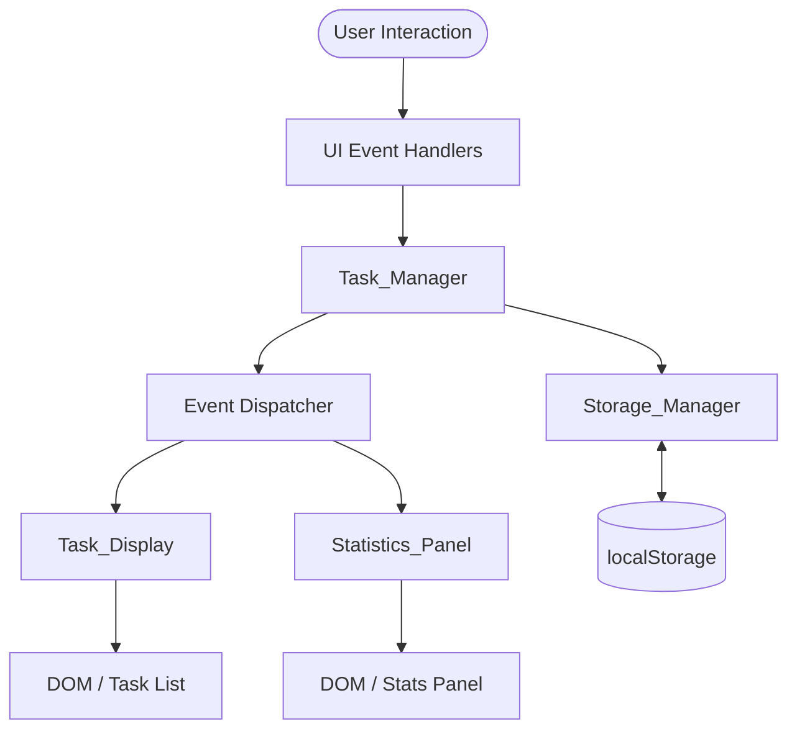
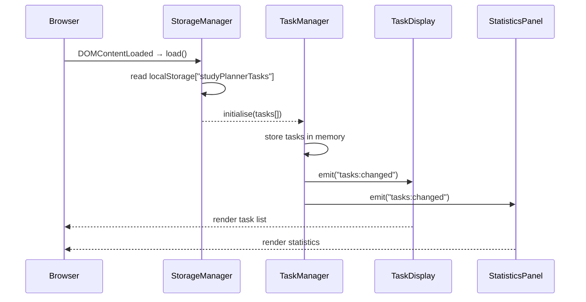

# Design Document

## Overview

The Smart Student Study Planner is a single-page, browser-based web application built with vanilla HTML, CSS, and JavaScript — no frameworks, no backend, no build step required. Students can open the HTML file directly in any modern browser.

The application lets students create study tasks with a title, subject, due date, and priority; track completion status; filter the visible list; and watch statistics update in real time. All data is persisted in the browser's `localStorage` under the key `studyPlannerTasks`, so tasks survive page refreshes and browser restarts without any server.

The architecture follows a simple module separation pattern: the **Task_Manager** owns in-memory state, the **Storage_Manager** handles persistence, the **Task_Display** handles DOM rendering, and the **Statistics_Panel** handles computed statistics. An event-driven coordination layer wires them together through a lightweight pub/sub dispatcher — avoiding tight coupling while keeping the codebase readable without a framework.

---

## Architecture

### High-Level Data Flow



### Module Responsibilities

| Module | Responsibility |
|---|---|
| `Task_Manager` | CRUD operations on the in-memory task array; emits change events |
| `Storage_Manager` | Serialise/deserialise the task array to/from localStorage; error handling |
| `Task_Display` | Render the task list, empty states, and deletion confirmation prompt |
| `Statistics_Panel` | Compute and render total/completed/pending/percentage and progress bar |
| `Event Dispatcher` | Lightweight pub/sub (`on` / `emit`) wiring modules without direct coupling |
| `UI Controllers` | Attach DOM event listeners for form submit, filter buttons, toggles, delete |

### Initialisation Sequence



---

## Components and Interfaces

### Task_Manager

```
createTask(title, subject, dueDate, priority) → Task | ValidationError
toggleCompletion(taskId) → Task
deleteTask(taskId) → void
getTasks() → Task[]
getFilteredTasks(filter: "All" | "Pending" | "Completed") → Task[]
initialise(tasks: Task[]) → void
```

- Validates all fields before creating a task (see Requirement 1 rules).
- Assigns a UUID (`crypto.randomUUID()`) as the task `id`.
- Emits `"tasks:changed"` after every mutating operation.
- On `Storage_Manager` write failure during toggle or delete, retains the mutation in memory, emits `"storage:error"`, and (for delete) reverses the in-memory change to satisfy the rollback requirement.

### Storage_Manager

```
save(tasks: Task[]) → { ok: boolean; error?: string }
load() → { tasks: Task[]; warnings: string[] }
```

- `save` serialises the array to JSON and writes it to `localStorage["studyPlannerTasks"]`. Returns `{ ok: false, error }` on `QuotaExceededError` or any other write failure.
- `load` reads and JSON-parses the stored string. Returns `{ tasks: [], warnings: [] }` on missing/null/invalid JSON. Filters out malformed objects (missing any required field) and surfaces them as `warnings`.

### Task_Display

```
render(tasks: Task[], filter: ActiveFilter) → void
showConfirmDialog(taskId, onConfirm, onCancel) → void
showError(message: string) → void
```

- Listens to `"tasks:changed"` and re-renders the task list using the current active filter.
- Applies visual styling per priority (red/orange/green left border) and per completion status (strikethrough, opacity 0.5).
- Shows an empty-state message when the filtered list is empty.
- Manages a simple modal/inline confirmation prompt for deletion.

### Statistics_Panel

```
update(tasks: Task[]) → void
```

- Listens to `"tasks:changed"` and recomputes: total, completed, pending, percentage (rounded to nearest whole number, `Math.round`).
- Updates the progress bar CSS width as a percentage string.

### UI Controllers

- **FilterController**: Manages the three filter buttons (All / Pending / Completed). Persists the active filter to `sessionStorage` so it survives in-page navigation while being reset on a fresh browser session. Dispatches a re-render on filter change.
- **FormController**: Attaches a `submit` listener to the task creation form. Reads and validates inputs, calls `Task_Manager.createTask`, shows inline field-level error messages on failure.

### Event Dispatcher

```javascript
const EventBus = {
  handlers: {},
  on(event, handler) { ... },
  emit(event, data) { ... }
};
```

Modules register listeners with `EventBus.on` and publish with `EventBus.emit`. This keeps modules independent and makes the flow easy to trace.

---

## Data Models

### Task Object

```typescript
interface Task {
  id: string;           // UUID, assigned on creation
  title: string;        // 1–100 characters
  subject: string;      // 1–50 characters
  dueDate: string;      // ISO 8601 date string "YYYY-MM-DD"
  priority: "Low" | "Medium" | "High";
  status: "Pending" | "Completed";
  createdAt: string;    // ISO 8601 datetime, used for secondary sort
}
```

### localStorage Schema

```
Key:   "studyPlannerTasks"
Value: JSON.stringify(Task[])
```

A well-formed stored value looks like:

```json
[
  {
    "id": "a1b2c3d4-...",
    "title": "Review Chapter 5",
    "subject": "Biology",
    "dueDate": "2025-08-01",
    "priority": "High",
    "status": "Pending",
    "createdAt": "2025-07-28T10:30:00.000Z"
  }
]
```

### Validation Rules

| Field | Rule |
|---|---|
| `title` | Required; 1–100 characters |
| `subject` | Required; 1–50 characters |
| `dueDate` | Required; must be ≥ today's calendar date |
| `priority` | Required; one of `"Low"`, `"Medium"`, `"High"` |
| `status` | Set to `"Pending"` on creation; toggled by user action |

### Filter State

```typescript
type ActiveFilter = "All" | "Pending" | "Completed";
// Persisted in sessionStorage["studyPlannerFilter"], default: "All"
```

---

## Correctness Properties

*A property is a characteristic or behavior that should hold true across all valid executions of a system — essentially, a formal statement about what the system should do. Properties serve as the bridge between human-readable specifications and machine-verifiable correctness guarantees.*

### Property 1: Task serialisation round-trip preserves all fields

*For any* valid task array (tasks with non-empty title ≤ 100 chars, non-empty subject ≤ 50 chars, a today-or-future dueDate, a valid priority, and any status), calling `Storage_Manager.save` followed by `Storage_Manager.load` shall return a task array where every field of every task is identical to the original — no data is lost, truncated, or mutated by the serialisation cycle.

**Validates: Requirements 7.1, 7.5**

### Property 2: Invalid inputs are always rejected and the task list is unchanged

*For any* combination of task creation inputs where at least one field violates a validation rule (title is empty or longer than 100 characters; subject is empty or longer than 50 characters; dueDate is absent or falls before today's calendar date; priority is absent or not one of the three valid values), `Task_Manager.createTask` shall return a `ValidationError` and `getTasks()` shall return the same array it contained before the call.

**Validates: Requirements 1.3, 1.4, 1.5, 1.6, 1.7**

### Property 3: Valid task creation always sets status to Pending

*For any* valid combination of title, subject, dueDate, and priority, the task produced by `Task_Manager.createTask` shall have `status === "Pending"` and shall appear in the list returned by `getTasks()`.

**Validates: Requirements 1.1, 1.8**

### Property 4: Completion toggle is an involution

*For any* task in any list, calling `Task_Manager.toggleCompletion` twice on the same task id shall leave that task's `status` equal to its value before either toggle — i.e., the operation is its own inverse.

**Validates: Requirements 3.1, 3.5**

### Property 5: Filter correctness — rendered list is exactly the matching subset

*For any* task list and any active filter value (`"All"`, `"Pending"`, or `"Completed"`), the set of tasks rendered by `Task_Display` shall be identical to the set produced by applying the filter predicate to the full task list: every task that matches is present, and no task that does not match appears in the rendered output.

**Validates: Requirements 5.1, 5.2, 5.3, 5.7**

### Property 6: Statistics and progress bar are always consistent with the task list

*For any* task list state (after any sequence of creates, toggles, and deletes), the values displayed by `Statistics_Panel` shall satisfy: `total = tasks.length`, `completed = tasks.filter(t => t.status === "Completed").length`, `pending = total − completed`, `percentage = Math.round((completed / total) × 100)` (treating the result as `0` when `total === 0`), and the CSS width of the progress bar filled region shall equal `percentage + "%"`.

**Validates: Requirements 6.1, 6.2, 6.3, 6.4, 6.5, 6.6, 6.7**

### Property 7: Partial-load preserves all well-formed tasks and discards only malformed ones

*For any* JSON array stored in localStorage that contains a mix of well-formed task objects (all required fields present) and malformed task objects (one or more required fields absent), `Storage_Manager.load` shall return exactly the well-formed tasks — no well-formed task is omitted, no malformed task is included — and the returned `warnings` array shall be non-empty.

**Validates: Requirements 7.3, 7.4**

---

## Error Handling

### Storage Write Failure (QuotaExceededError / SecurityError)

- `Storage_Manager.save` catches all exceptions and returns `{ ok: false, error: message }`.
- `Task_Manager` checks the return value after every mutating save. On failure:
  - For **create**: the task remains in memory (session-only) and `Task_Display.showError` is called (Requirement 3.6).
  - For **delete**: the task is restored to the in-memory list, the DOM entry is restored, and an error toast is shown (Requirement 4.5).
  - For **toggle**: the status change is kept in memory for the session and an error toast is shown (Requirement 3.6).

### Malformed localStorage Data

- `Storage_Manager.load` wraps `JSON.parse` in a try/catch. On parse failure it returns `{ tasks: [], warnings: [] }`.
- Missing or null value → empty task list, no warning.
- Valid JSON array with some malformed objects → malformed objects discarded, warning message surfaced (Requirement 7.4).
- `Task_Display.showError` is called with any non-empty warnings array on startup.

### Validation Errors

- Each validation failure in `Task_Manager.createTask` returns a structured error object `{ field, message }`.
- `FormController` maps each error to its corresponding form field and displays an inline error message below that field.
- The form submission is blocked until all validation passes.

### Confirmation Cancellation

- If the user cancels a deletion prompt, no data is modified — the prompt is dismissed and the task list is unchanged (Requirement 4.3).

---

## Testing Strategy

### Unit Tests

Unit tests cover specific behaviors with concrete examples and edge cases. They are written with a standard test runner (Jest or Vitest, whichever is installed in the project) and do not require a browser environment — modules are imported directly with localStorage mocked via `jest-localstorage-mock` or an equivalent.

**Focus areas:**

- `Task_Manager`: createTask with valid data, createTask with each invalid field permutation, toggleCompletion for Pending→Completed and Completed→Pending, deleteTask removes correct task.
- `Storage_Manager`: save then load returns identical data, load with missing key returns empty array, load with invalid JSON returns empty array, load with mixed valid/invalid objects filters correctly.
- `Statistics_Panel`: compute functions for zero tasks, one task, all completed, mixed.
- `FilterController`: default filter is "All", filter persists in sessionStorage.

### Property-Based Tests

Property-based tests verify universal behaviors across randomly generated inputs. The recommended library is **fast-check** (available via `npm install --save-dev fast-check`), configured to run a minimum of **100 iterations per property**.

Each test is tagged with a comment referencing its design property:

```
// Feature: smart-student-study-planner, Property N: <property_text>
```

**Property tests to implement:**

| Property | Test description |
|---|---|
| Property 1 | Generate random valid task arrays → `save` → `load` → assert deep equality of every field of every task |
| Property 2 | Generate inputs with at least one invalid field → `createTask` → assert `ValidationError` returned and `getTasks()` unchanged |
| Property 3 | Generate any valid inputs → `createTask` → assert `status === "Pending"` and task in `getTasks()` |
| Property 4 | Generate any task + toggle twice → assert `status` equals original value |
| Property 5 | Generate any task list + any filter value → render → assert rendered set equals filtered set exactly |
| Property 6 | Generate arbitrary task list states (via mutations) → assert `Statistics_Panel` values and progress bar width all match computed values |
| Property 7 | Generate JSON arrays with random mix of valid and malformed objects → `load` → assert valid tasks preserved exactly, `warnings` non-empty |

### Integration / Smoke Tests

Since this is a pure-frontend localStorage app with no external services, integration testing focuses on the wiring between modules:

- **Smoke test**: Application initialises without errors when localStorage is empty.
- **Smoke test**: Application initialises without errors when localStorage contains valid tasks.
- **Integration test**: End-to-end task lifecycle (create → complete → delete) verifies that the task list, statistics, and localStorage state are all consistent at each step.
- **Responsive layout test**: Manual or automated (Playwright) check that the two-column layout renders at ≥ 1024 px and single-column renders at ≤ 767 px.

### Accessibility Verification

WCAG 2.1 AA contrast and touch-target requirements (Requirement 8.4, 8.5) require manual validation with browser developer tools and assistive technology testing — automated tools can flag obvious failures but full validation requires human review.
